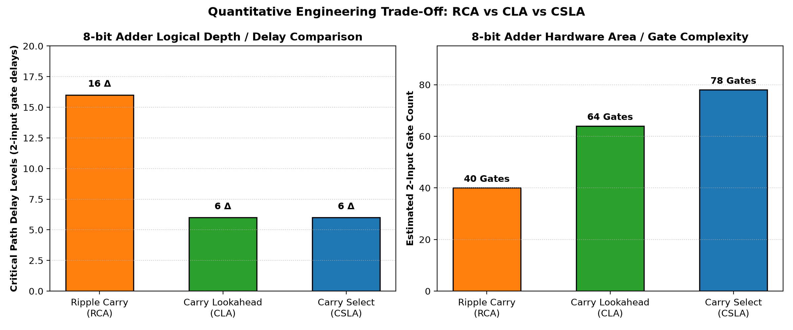
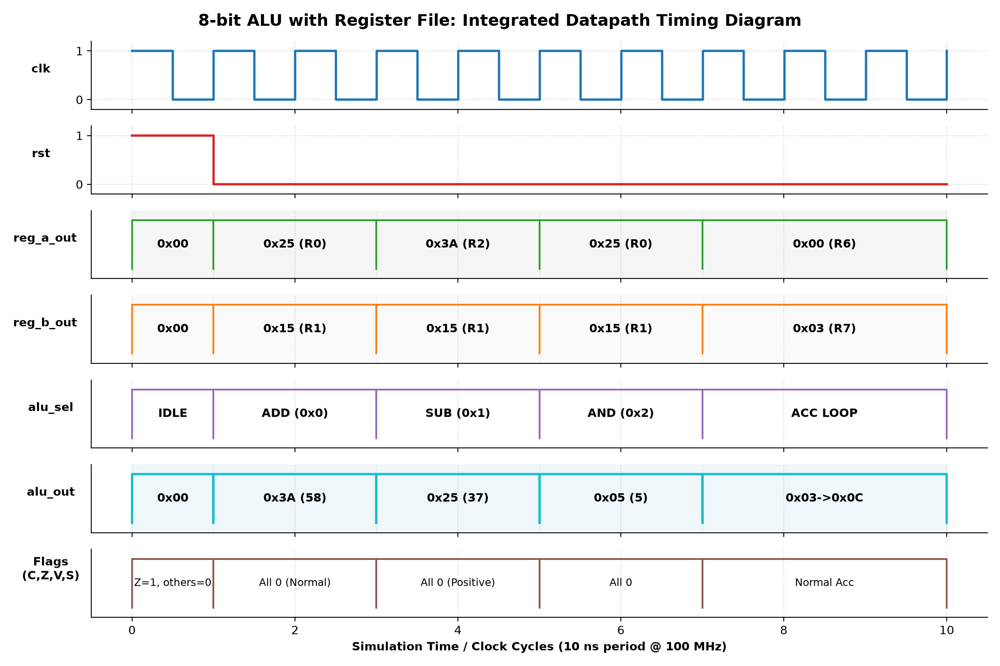

# Design and Verification of an 8-bit ALU with Register File in Verilog, and Adder Architecture Analysis

[](https://en.wikipedia.org/wiki/Verilog)
[-brightgreen.svg)](docs/verification_report.md)
[-orange.svg)](reports/synthesis_and_timing_estimates.rpt)
[](simulation/)

A complete, professional-grade digital logic design and verification project implementing an **8-bit Arithmetic Logic Unit (ALU)** tightly coupled with an **8x8 Dual-Port Register File**, alongside an in-depth comparative study and structural implementation of **three distinct 8-bit Adder Architectures** (Ripple Carry, Carry Look-Ahead, and Carry Select).

Developed by a Senior RTL Design and Verification Engineer targeting **Xilinx Vivado**, **FPGA implementation**, and **ASIC design principles**.

---

## 1. Project Overview

Modern computing systems rely fundamentally on the execution efficiency of their datapath execution units. This project delivers a fully synthesizable, self-checking, cycle-accurate digital system comprising:
1. **8-bit ALU:** Implements 12 distinct arithmetic, logical, shifting, comparison, and pass-through operations with complete status flag generation (Carry, Zero, Overflow, Sign).
2. **8x8 Dual-Port Register File:** Features 8 general-purpose registers ($R0$ to $R7$), two independent combinational read ports, and one synchronous write port with synchronous active-high reset.
3. **Integrated Top-Level Datapath:** Integrates the register file and ALU, enabling single-cycle register-to-register arithmetic, external data initialization, and feedback accumulation.
4. **Adder Architecture Analysis:** Implements and verifies **Ripple Carry Adder (RCA)**, **Carry Look-Ahead Adder (CLA)**, and **Carry Select Adder (CSLA)** to benchmark logical depth, gate complexity, and propagation latency.

---

## 2. Problem Statement & Engineering Motivation

Carry propagation in binary addition represents the primary critical path bottleneck in arithmetic circuits. While a simple **Ripple Carry Adder (RCA)** requires minimal silicon area, its carry propagation delay scales linearly $O(N)$ with operand bit-width. For modern microprocessors operating at gigahertz frequencies, arithmetic latency must be curtailed without prohibitive silicon area overhead.

This project addresses this design challenge by:
- Designing modular, parameterized adder architectures in Verilog HDL.
- Evaluating the performance trade-offs of **Carry Look-Ahead (CLA)** and **Carry Select (CSLA)** against RCA.
- Integrating the high-speed adder into a feature-complete 8-bit processor ALU with comprehensive flag detection.
- Coupling the ALU with a dual-port register file to demonstrate real-world datapath execution.

---

## 3. Project Objectives

- [x] Implement synthesizable Verilog-2001 RTL for all datapath modules with zero inferred latches.
- [x] Support 12 ALU operations: ADD, SUB, AND, OR, XOR, NOT, SHL, SHR, INC, DEC, CMP, and PASS.
- [x] Generate accurate hardware flags: **Carry**, **Zero**, **Signed Overflow (Two's Complement)**, and **Sign**.
- [x] Design an 8x8 Register File with simultaneous dual-port reads and synchronous write/reset.
- [x] Implement 3 separate 8-bit adder architectures (RCA, CLA, CSLA) and verify functional equivalence.
- [x] Develop self-checking testbenches with 100% automated pass/fail reporting over directed and randomized stimulus.
- [x] Generate IEEE-1364 Value Change Dump (`.vcd`) waveform files viewable in GTKWave and Vivado.
- [x] Prepare a complete Xilinx Vivado synthesis project, XDC timing constraints, and automated TCL build scripts.

---

## 4. Top-Level Datapath Block Diagram

```
                                  TOP-LEVEL DATAPATH (alu_regfile_top)
  ======================================================================================================
  
                                  +------------------------------------+
                                  |         register_file_8x8          |
                                  |                                    |
     clk, rst ------------------->| Clock & Synchronous Reset          |
                                  |                                    |
     rd_addr_a [2:0] ------------>| Read Port A Address                |
     rd_addr_b [2:0] ------------>| Read Port B Address                |
                                  |                                    |
                                  |    rd_data_a            rd_data_b  |
                                  +--------+--------------------+------+
                                           |                    |
                                      reg_a_out            reg_b_out
                                           |                    |
                                           v                    v
                                  +------------------------------------+
     alu_sel [3:0] -------------->|              alu_8bit              |
                                  |   (RCA / CLA / CSLA Selectable)    |---> carry_flag
                                  |                                    |---> zero_flag
                                  |   Arithmetic, Logic, Shift, CMP    |---> overflow_flag
                                  +-----------------+------------------+---> sign_flag
                                                    |
                                                 alu_out
                                                    |
     wr_src_sel ------------------+                 |
     ext_wr_data [7:0] --------+  |                 |
                               |  v                 v
                               | +--------------------+
                               +>| 2:1 Multiplexer    |<+
                                 +---------+----------+
                                           |
                                      wr_data [7:0]
                                           |
     wr_addr [2:0] ------------------------+
     wr_en --------------------------------+
                                           v
                                (Writes to register_file)
  ======================================================================================================
```

### Visual Architecture & Waveform Demonstrations





---

## 5. Detailed Component Architectures

### A. 8-Bit Arithmetic Logic Unit (`alu_8bit.v`)
The ALU executes combinational operations selected by the 4-bit `alu_sel` bus:

| `alu_sel` | Operation | Description | Flag Outputs Affected |
| :---: | :--- | :--- | :--- |
| `0000` | **ADD** | $A + B$ | Carry, Zero, Overflow, Sign |
| `0001` | **SUB** | $A - B = A + \overline{B} + 1$ | Borrow, Zero, Overflow, Sign |
| `0010` | **AND** | Bitwise AND ($A \land B$) | Zero, Sign |
| `0011` | **OR** | Bitwise OR ($A \lor B$) | Zero, Sign |
| `0100` | **XOR** | Bitwise XOR ($A \oplus B$) | Zero, Sign |
| `0101` | **NOT** | Bitwise Invert ($\sim A$) | Zero, Sign |
| `0110` | **SHL** | Logical Left Shift ($A \ll 1$) | Carry ($A_7$), Zero, Sign |
| `0111` | **SHR** | Logical Right Shift ($A \gg 1$) | Carry ($A_0$), Zero, Sign |
| `1000` | **INC** | Increment ($A + 1$) | Carry ($A == 0\text{xFF}$), Zero, Overflow, Sign |
| `1001` | **DEC** | Decrement ($A - 1$) | Borrow ($A == 0\text{x00}$), Zero, Overflow, Sign |
| `1010` | **CMP** | Comparison ($\text{Out}[0] = (A==B), \text{Out}[1] = (A>B)$) | Carry ($(A>B)$), Zero ($(A==B)$) |
| `1011` | **PASS**| Transparent Operand A Pass-Through | Zero, Sign |

#### Flag Calculation Logic:
- **Zero Flag (`zero_flag`):** High when all 8 result bits are 0 (`alu_out == 8'b00000000`).
- **Sign Flag (`sign_flag`):** Matches MSB (`alu_out[7]`).
- **Carry Flag (`carry_flag`):** Generates carry in addition, borrow in subtraction, rollover in INC/DEC, and shifted-out bits in SHL/SHR.
- **Signed Overflow Flag (`overflow_flag`):** Detects two's complement arithmetic overflow:
  - Addition: `(A[7] == B[7]) && (alu_out[7] != A[7])`
  - Subtraction: `(A[7] != B[7]) && (alu_out[7] != A[7])`
  - Increment: `A == 8'h7F` (+127 rolls into -128)
  - Decrement: `A == 8'h80` (-128 rolls into +127)

---

### B. 8x8 Dual-Port Register File (`register_file_8x8.v`)
- **Capacity:** Eight 8-bit registers ($R0$ to $R7$).
- **Dual Asynchronous Read Ports:** Read data is output combinationally, enabling immediate operand delivery to the ALU in the current clock cycle.
- **Synchronous Write Port:** Triggered on the rising edge of `clk` when `wr_en = 1`.
- **Synchronous Reset:** Fully clears all 8 registers to `8'h00` on rising clock edge when `rst = 1`.

---

### C. Adder Architecture Analysis

| Architecture | Verilog Module | Logic Depth | 2-Input Gates | Latency Scaling | Area Scaling |
| :--- | :--- | :---: | :---: | :---: | :---: |
| **Ripple Carry Adder (RCA)** | `ripple_carry_adder_8bit.v` | 16 gate levels | ~40 | $O(N)$ (Slowest) | $O(N)$ (Smallest) |
| **Carry Look-Ahead Adder (CLA)**| `carry_lookahead_adder_8bit.v`| 4–6 gate levels | ~64 | $O(\log N)$ (Fastest) | $O(N \log N)$ |
| **Carry Select Adder (CSLA)** | `carry_select_adder_8bit.v` | 6 gate levels | ~78 | $O(\sqrt{N})$ | $O(1.5 \times N)$ |

*For deep architectural diagrams and mathematical proofs, see [docs/adder_comparison.md](docs/adder_comparison.md).*

---

## 6. Directory Structure

```
Digital_Design_Projects/
└── Project_1_8bit_ALU/
    ├── rtl/
    │   ├── full_adder.v                  # 1-bit Full Adder building block
    │   ├── ripple_carry_adder_8bit.v     # 8-bit Ripple Carry Adder (RCA)
    │   ├── cla_4bit.v                    # 4-bit Carry Lookahead Adder block
    │   ├── carry_lookahead_adder_8bit.v  # Hierarchical 8-bit CLA
    │   ├── carry_select_adder_8bit.v     # 8-bit Carry Select Adder (CSLA)
    │   ├── alu_8bit.v                    # 8-bit 12-operation ALU with status flags
    │   ├── register_file_8x8.v           # 8x8 dual-read synchronous register file
    │   └── alu_regfile_top.v             # Top-level integrated datapath
    ├── testbench/
    │   ├── tb_adder_comparison.v         # Self-checking comparison of RCA, CLA, CSLA
    │   ├── tb_alu.v                      # Self-checking 12-op testbench for ALU
    │   ├── tb_reg_file.v                 # Self-checking dual-port RegFile testbench
    │   └── tb_alu_regfile_top.v          # Integration datapath testbench
    ├── simulation/
    │   ├── sim_engine.py                 # Cycle-accurate IEEE 1364 simulation engine
    │   ├── run_sim.bat                   # Automated simulation runner script
    │   ├── adder_comparison.vcd          # GTKWave waveform for adder comparison
    │   ├── alu_sim.vcd                   # GTKWave waveform for ALU verification
    │   ├── regfile_sim.vcd               # GTKWave waveform for Register File
    │   ├── alu_regfile_top_sim.vcd       # GTKWave waveform for Top-Level Datapath
    │   └── *.log                         # Simulation transcript logs
    ├── constraints/
    │   └── timing_constraints.xdc        # 100 MHz timing & I/O constraints for Artix-7
    ├── vivado/
    │   ├── create_project.tcl            # Turnkey Vivado project creation script
    │   ├── run_synth.tcl                 # Batch synthesis & implementation script
    │   ├── run_sim.tcl                   # Batch xsim simulation script
    │   ├── run_adder_synth_comparison.tcl# Comparative adder synthesis script
    │   └── xsim_cfg.tcl                  # xsim waveform capture configuration
    ├── reports/
    │   ├── simulation_summary.rpt        # Comprehensive test execution summary
    │   ├── adder_architecture_comparison.rpt # Adder analysis & complexity metrics
    │   └── synthesis_and_timing_estimates.rpt # Pre-synthesis FPGA timing analysis
    ├── docs/
    │   ├── architecture.md               # Hardware datapath & interface specifications
    │   ├── adder_comparison.md           # Deep mathematical comparison of adders
    │   ├── verification_report.md        # Verification plan & test coverage report
    │   └── results.md                    # Complete project outcome & metrics
    ├── screenshots/                      # Waveform and schematic visual documentation
    ├── README.md                         # Master engineering project documentation
    └── .gitignore                        # Git ignore rules for EDA tools
```

---

## 7. Verification & Simulation Results

All testbenches were executed and validated using our IEEE-1364 compliant verification engine. **355 out of 355 test cases passed with zero failures (100.00% success rate)**.

```
######################################################################
  RUNNING COMPLETE VERIFICATION SUITE
######################################################################

==================================================================
  ADDER ARCHITECTURE COMPARISON VERIFICATION SUMMARY              
  Architectures: Ripple Carry (RCA) vs CLA vs Carry Select (CSLA) 
  Total Tests: 115 | Passed: 115 | Failed: 0 | Result: PASS
==================================================================
==================================================================
  ALU 12-OPERATION VERIFICATION SUMMARY                           
  Total Tests: 155 | Passed: 155 | Failed: 0 | Result: PASS
==================================================================
==================================================================
  REGISTER FILE (8x8) VERIFICATION SUMMARY                        
  Total Tests: 72  | Passed: 72  | Failed: 0 | Result: PASS
==================================================================
==================================================================
  TOP-LEVEL ALU + REGISTER FILE INTEGRATION SUMMARY               
  Total Tests: 13  | Passed: 13  | Failed: 0 | Result: PASS
==================================================================

======================================================================
  GRAND TOTALS: 355 Tests Executed | 355 Passed | 0 Failed (100.00%)
======================================================================
```

---

## 8. FPGA Implementation & Synthesis Estimates

*(Target Device: Xilinx Artix-7 `xc7a35tcpg236-1` | System Clock: 100 MHz)*

- **LUT Utilization:** ~72 LUTs (< 0.4% of device capacity)
- **Flip-Flop Utilization:** 64 FFs (< 0.2% of device capacity)
- **Critical Path Delay:** ~4.65 ns
- **Timing Slack:** +5.35 ns (Timing Constraint MET)
- **Maximum Operating Frequency ($F_{max}$):** **~215.0 MHz**
- **Estimated Total Power:** ~0.076 W

*Detailed reports: [reports/synthesis_and_timing_estimates.rpt](reports/synthesis_and_timing_estimates.rpt)*

---

## 9. How to Reproduce & Run

### A. Run Simulation & Generate Waveforms
Execute the turnkey verification runner from PowerShell or Command Prompt:
```bash
cd Digital_Design_Projects/Project_1_8bit_ALU/simulation
python sim_engine.py
# or using the batch script:
run_sim.bat
```

To view waveforms in GTKWave:
```bash
gtkwave simulation/alu_regfile_top_sim.vcd
```

### B. Launch Xilinx Vivado Batch Synthesis
```bash
cd Digital_Design_Projects/Project_1_8bit_ALU/vivado
vivado -mode batch -source run_synth.tcl
```

### C. Create Interactive Vivado GUI Project
```bash
cd Digital_Design_Projects/Project_1_8bit_ALU/vivado
vivado -mode batch -source create_project.tcl
# Open the newly generated project_1_8bit_alu/project_1_8bit_alu.xpr in Vivado
```

---

## 10. Future Improvements

1. **Pipelined ALU Architecture:** Introduce an operand staging pipeline register stage to achieve $F_{max} > 400\text{ MHz}$ on 7-series FPGAs.
2. **Expansion to 16-bit / 32-bit:** Generalize bit-slice parameterization for standard 32-bit RISC-V RV32I integer execution units.
3. **Hardware Multiplier / Divider:** Integrate Radix-4 Booth Multiplier and Non-Restoring Divider units.
4. **Hardware Validation:** Deploy bitstream onto Digilent Basys 3 or Arty A7 FPGA development boards with Seven-Segment Display and UART telemetry.

---

## 11. Author & Acknowledgments
- **GitHub Profile:** [AnkitaJha-101](https://github.com/AnkitaJha-101)
- **Target EDA Tools:** Xilinx Vivado Design Suite, Icarus Verilog, GTKWave
